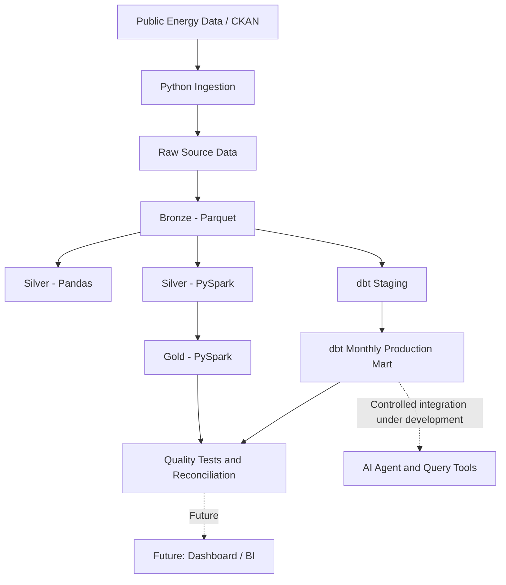

# Argentina Oil & Gas Data Platform

An end-to-end Data Engineering project for ingesting, transforming, validating, and analyzing public oil and gas production data from Argentina.

The platform uses Python, Pandas, PySpark, DuckDB, and dbt to build a reproducible analytical pipeline, with a focus on data quality, transformation consistency, and production analytics.

**Project status:** Core ingestion, transformation, analytical modeling, and data reconciliation components are implemented. Containerization, automated CI/CD, orchestration, and cloud deployment are planned.

## Overview

This project explores how public oil and gas production data can be transformed into reliable analytical datasets using modern Data Engineering practices.

The source data is obtained from Argentina's public energy data infrastructure through CKAN. The pipeline progressively separates raw source data, standardized datasets, and business-oriented analytical outputs.

The project also includes an AI agent module with tools designed to interact with production-related data.

### Key objectives

- Ingest public datasets through a programmatic CKAN client.
- Preserve source data and separate storage layers.
- Implement Silver transformations using both Pandas and PySpark.
- Build aggregated Gold datasets using PySpark.
- Create analytical models with dbt and DuckDB.
- Validate data quality through automated tests and business rules.
- Reconcile analytical results produced by different processing engines.
- Develop a foundation for future orchestration, cloud deployment, and AI-assisted analytics.

## Architecture



The diagram represents the project's logical architecture. Not every connection is currently orchestrated as a single automated workflow.

### Data layers

| Layer | Responsibility | Implementation |
|---|---|---|
| Raw | Preserve source extracts for traceability | Python ingestion and local storage |
| Bronze | Store source data in a columnar format | Parquet |
| Silver | Standardize and transform source datasets | Pandas and PySpark |
| Gold | Produce aggregated analytical datasets | PySpark |
| Analytics | Build SQL models for downstream analysis | dbt + DuckDB |

Raw and Bronze represent distinct logical responsibilities. Their physical storage paths and execution steps depend on the existing ingestion implementation.

## Technology stack

| Technology | Purpose |
|---|---|
| Python | Ingestion, transformation logic, validation, and integration |
| Pandas | Data exploration and local transformations |
| PySpark | Distributed data processing and analytical aggregation |
| Parquet | Columnar storage for processed datasets |
| DuckDB | Local analytical SQL engine |
| dbt | SQL modeling and data quality tests |
| pytest | Automated Python testing |
| Git and GitHub | Version control and project collaboration |
| Jupyter Notebook | Data exploration and discovery |

Additional components in `src/ai/` provide an extensible foundation for AI-assisted data access.

## Repository structure

```text
Argentina-oil-gas-data-platform/
├── docs/
│   └── data_discovery.md
├── notebooks/
│   └── 01_data_exploration.ipynb
├── oil_gas_analytics/
│   ├── models/
│   │   ├── staging/
│   │   │   └── stg_production.sql
│   │   └── marts/
│   │       ├── fct_monthly_production.sql
│   │       └── schema.yml
│   ├── tests/
│   │   ├── monthly_totals_match_staging.sql
│   │   ├── non_negative_monthly_production.sql
│   │   └── unique_monthly_production_key.sql
│   ├── dbt_project.yml
│   └── README.md
├── src/
│   ├── ai/
│   │   ├── schemas/
│   │   ├── tools/
│   │   ├── agent.py
│   │   ├── fake_llm.py
│   │   ├── llm_client.py
│   │   └── llm_interface.py
│   ├── ingestion/
│   │   └── ckan_client.py
│   ├── quality/
│   │   ├── compare_dbt_gold.py
│   │   └── data_quality.py
│   └── transformation/
│       ├── gold_spark.py
│       ├── silver.py
│       └── silver_spark.py
├── tests/
│   ├── test_agent.py
│   ├── test_data_quality.py
│   ├── test_gold_spark.py
│   ├── test_history_tool.py
│   ├── test_production_tool.py
│   └── test_spark_silver.py
├── .gitignore
├── requirements.txt
└── README.md
```

Generated dbt artifacts, local databases, virtual environments, and raw or processed data files are excluded from version control where configured.

## Data source and discovery

The project uses public oil and gas production information from Argentina's energy data infrastructure, accessed through CKAN.

The exploratory analysis investigates the data grain, candidate keys, missing values, zero-heavy variables, and differences between source resources.

Detailed findings are documented in [`docs/data_discovery.md`](docs/data_discovery.md).

### Preliminary findings

The 2026 dataset samples investigated contain approximately 650,000 records and 38 columns, with exact row counts varying by resource and extract.

Findings include:

- `idempresa + anio + mes + idpozo` is a candidate natural key for the observed production grain.
- The data appears to represent production at company, well, and month level.
- The standard Production and DDJJ resources contain different numbers of records.
- A preliminary comparison identified 1,563 DDJJ records without a matching key in the Production resource.
- Several production and injection variables contain many zero values.
- `iny_co2` contained only zeros in the 2026 sample investigated so far.
- Missing values, extreme observations, and near-zero floating-point values require further business interpretation.

These observations are exploratory, not universal data-quality rules. In particular, differences between source resources should be investigated before being classified as missing or invalid production records.

## Pipeline implementation

### 1. Ingestion

The CKAN client in `src/ingestion/ckan_client.py` provides the foundation for retrieving source metadata and resources programmatically.

The objective is to reduce manual downloads and support reproducible source extraction.

### 2. Silver transformations

Two transformation implementations are maintained:

- Pandas: `src/transformation/silver.py`
- PySpark: `src/transformation/silver_spark.py`

Their equivalence has been tested to check that both implementations produce consistent standardized data.

### 3. Gold analytics

`src/transformation/gold_spark.py` implements the PySpark Gold layer, aggregating production data into a monthly analytical dataset.

This layer provides the basis for downstream SQL modeling and production analysis.

### 4. dbt and DuckDB

The dbt project is located in `oil_gas_analytics/`.

**Staging model:** `stg_production.sql`

Prepares the production data for analytical modeling.

**Mart model:** `fct_monthly_production.sql`

Builds a monthly production fact dataset for analytical consumption.

The project materializes staging models as views and marts as tables, according to `dbt_project.yml`.

### 5. Reconciliation across processing engines

The validation script `src/quality/compare_dbt_gold.py` compares the dbt analytical mart against the PySpark Gold output.

This provides a cross-engine consistency check rather than relying solely on tests within a single implementation.

## Data quality and testing

The project includes Python tests, PySpark tests, dbt schema tests, SQL data tests, and an explicit reconciliation between analytical outputs.

Examples of implemented checks include:

- Validation of the equivalence between Pandas and PySpark Silver transformations.
- Business-oriented data-quality checks.
- Uniqueness of the monthly production key.
- Non-negative monthly production values.
- Consistency of monthly totals with staging data.
- Reconciliation of dbt and PySpark Gold results.

### Verified reconciliation result

One recorded execution produced the following results:

| Metric | Result |
|---|---:|
| Rows in dbt mart | 136 |
| Rows in PySpark Gold | 136 |
| Keys only in dbt | 0 |
| Keys only in PySpark | 0 |
| Matching keys | 136 |

This confirms key-level reconciliation for that execution. It does not, by itself, establish that every individual measure is identical or that all source data is correct.

### Recorded processing volume

A previous pipeline execution processed 653,543 records across 38 columns. This figure describes that particular execution, not a permanent dataset size or a guaranteed volume for future runs.

## AI integration

The repository contains an AI module under `src/ai/`, including:

- An agent entry point.
- An LLM interface and client.
- Production and history tools.
- Tool definitions and a registry.
- Pydantic schemas for production-related data.
- A fake LLM implementation for development and testing.

The intended direction is to let an AI agent answer questions using controlled access to validated analytical datasets.

Future improvements include tool-level validation, traceable SQL or metric results, response evaluation, and explicit safeguards against fabricated production figures.

The presence of these components does not imply that the agent is already deployed as a production service or integrated with a live cloud data platform.

## Getting started

### Prerequisites

- Git
- Python compatible with the pinned project dependencies
- Java compatible with the installed PySpark version
- A configured dbt profile for DuckDB

The project has been developed and tested in a local Windows environment. Other operating systems may require adjustments to environment setup and execution commands.

### 1. Clone the repository

```powershell
git clone https://github.com/Silvito/Argentina-oil-gas-data-platform.git
cd Argentina-oil-gas-data-platform
```

### 2. Create and activate a virtual environment

```powershell
py -m venv .venv
.\.venv\Scripts\Activate.ps1
```

If PowerShell prevents activation, use an approved execution-policy configuration for your environment rather than changing system-wide security settings unnecessarily.

### 3. Install dependencies

```powershell
python -m pip install --upgrade pip
pip install -r requirements.txt
```

The dependency file pins package versions to improve reproducibility. Compatibility should be validated on a clean environment before claiming support for a particular Python or Java version.

### 4. Configure dbt

Create a dbt profile in the standard location:

`%USERPROFILE%\.dbt\profiles.yml`

The profile name must match `oil_gas_analytics`, as declared in `dbt_project.yml`.

Configure the DuckDB adapter and the appropriate local database path for your environment. Avoid committing machine-specific paths or secrets.

### 5. Validate the dbt project

From the repository root:

```powershell
dbt debug --project-dir oil_gas_analytics
dbt compile --project-dir oil_gas_analytics
```

These commands validate the configured connection and compile the SQL models. A successful compilation does not guarantee that upstream source data is available for execution.

## Running tests

### Python tests

Run the existing test suite from the repository root:

```powershell
python -m pytest -v
```

Tests that require source data, a particular environment, or an external service may need additional configuration.

### dbt tests

After configuring the profile and ensuring the expected source relation exists:

```powershell
dbt test --project-dir oil_gas_analytics
```

To build models and execute applicable tests together:

```powershell
dbt build --project-dir oil_gas_analytics
```

The actual source configuration and execution order should be checked against the current dbt models before running the full build.

### Reconcile dbt and PySpark Gold

The repository includes a dedicated comparison script:

```powershell
python .\src\quality\compare_dbt_gold.py
```

Run it after producing the required Gold dataset and building the corresponding dbt mart. The script depends on the local data and database configuration expected by its implementation.

The reconciliation is designed to identify keys that exist in only one result. Consult the script and its output to determine which additional measure-level comparisons are performed.

## Current status and roadmap

| Component | Status |
|---|---|
| CKAN ingestion client | Implemented |
| Raw/Bronze storage | Implemented in the existing local pipeline |
| Pandas Silver | Implemented |
| PySpark Silver | Implemented |
| Pandas/PySpark equivalence validation | Implemented and tested |
| PySpark Gold aggregation | Implemented |
| dbt staging and mart models | Implemented |
| dbt data-quality tests | Implemented |
| dbt/PySpark reconciliation | Implemented and executed successfully |
| AI agent and query tools | Present in the codebase; capabilities are under development |
| Docker | Planned |
| GitHub Actions CI/CD | Planned |
| Airflow orchestration | Planned |
| Azure Data Lake Storage Gen2 | Planned |
| Cloud Databricks | Planned |
| Power BI dashboard | Planned |
| Automated anomaly detection | Planned |

### Next engineering milestones

1. Finalize repository documentation and validate a clean local setup.
2. Standardize test execution across Python, PySpark, and dbt.
3. Containerize the environment with Docker.
4. Add GitHub Actions workflows for automated testing.
5. Orchestrate ingestion, transformations, dbt, and validation with Airflow.
6. Evaluate cloud storage and processing with Azure and Databricks.
7. Publish analytical metrics through a dashboard.
8. Expand the AI agent with grounded, auditable data access.

## Engineering principles

The project follows several principles:

- **Preserve source data:** retain the ability to investigate and reproduce transformations.
- **Separate responsibilities:** distinguish ingestion, standardization, analytical aggregation, and modeling.
- **Validate transformations:** compare implementations and test business assumptions.
- **Avoid arbitrary cleaning:** investigate anomalies and missing values before removing records.
- **Build incrementally:** introduce infrastructure when it solves a specific engineering problem.
- **Keep results traceable:** distinguish measured outcomes from preliminary findings and future goals.

## Author

**Silvio Martinez**

Data Engineering | Python | SQL | PySpark | dbt | Data Quality

Argentina

GitHub: [Silvito](https://github.com/Silvito)
